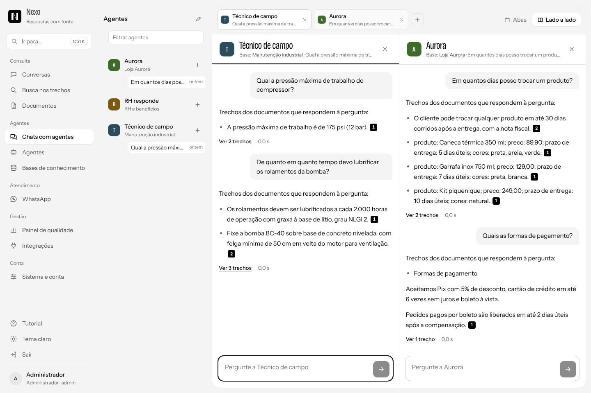
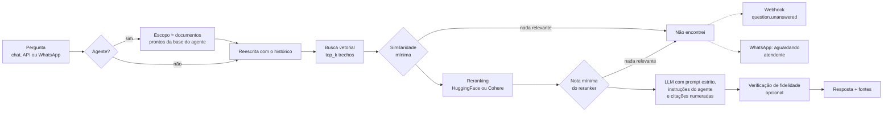
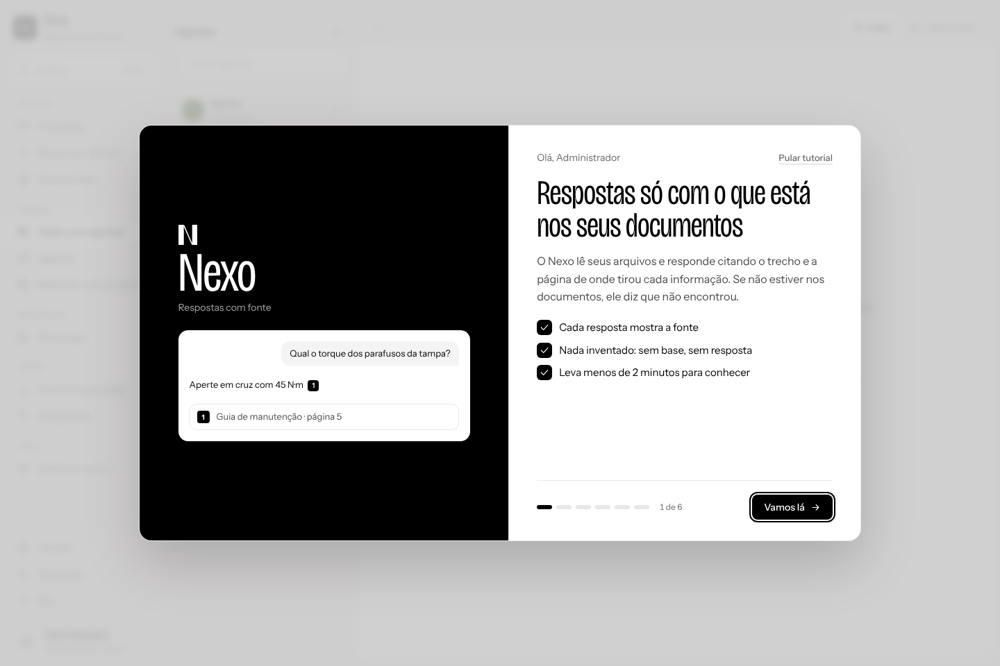
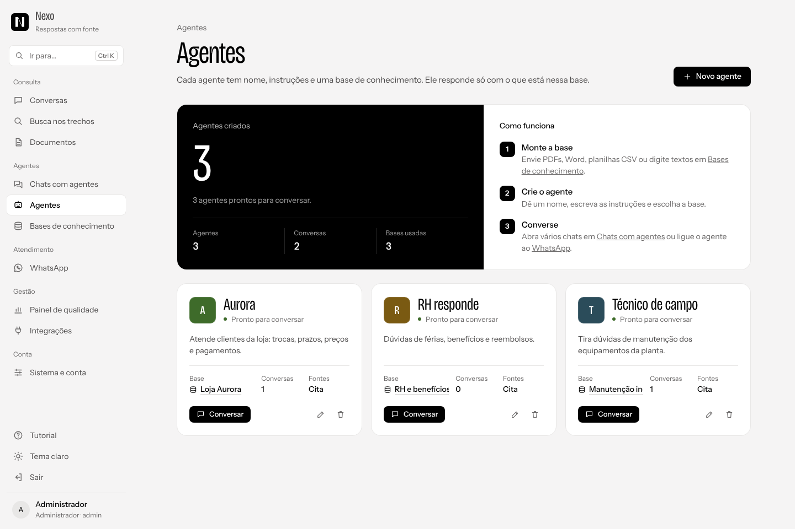
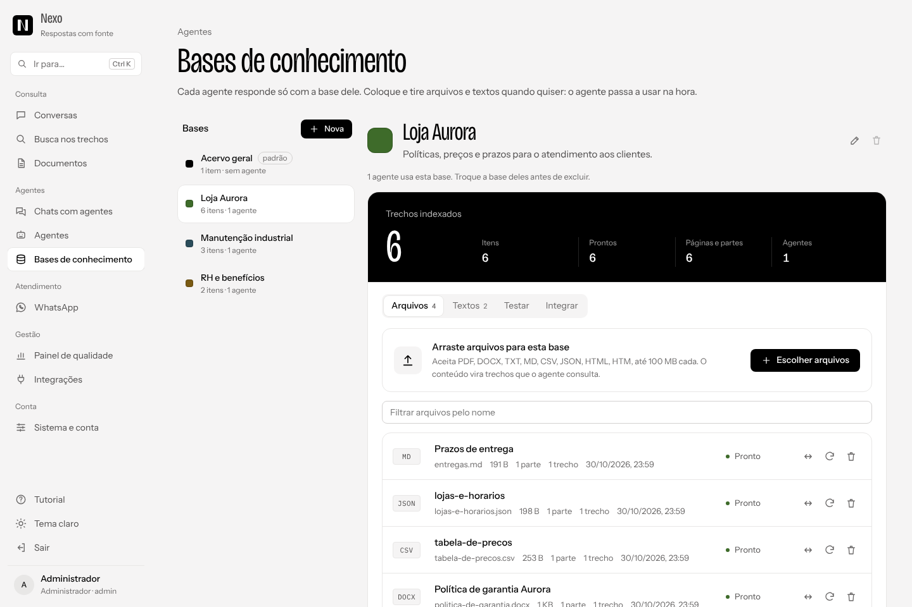
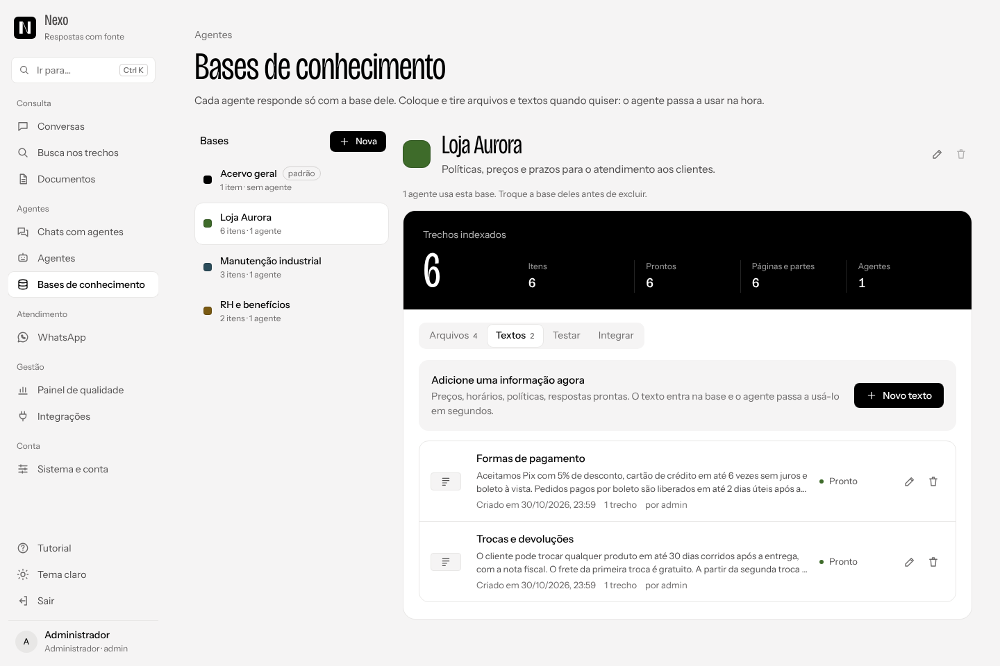
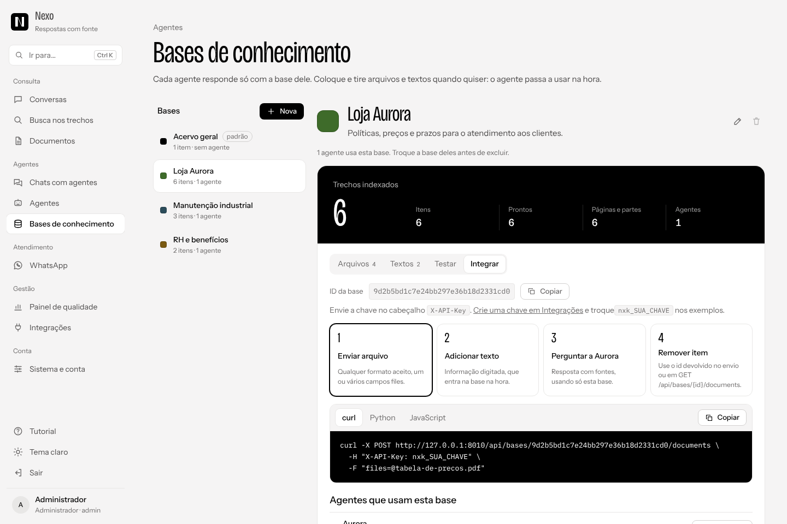
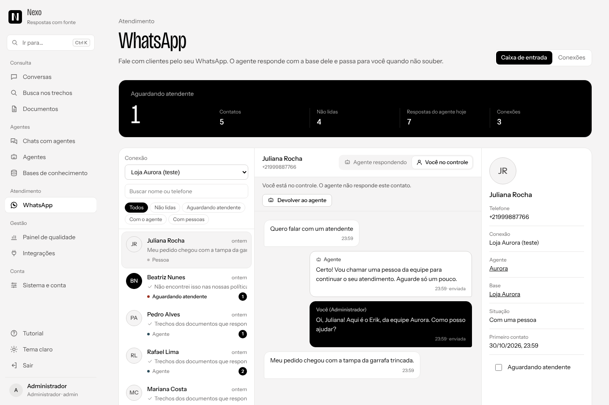
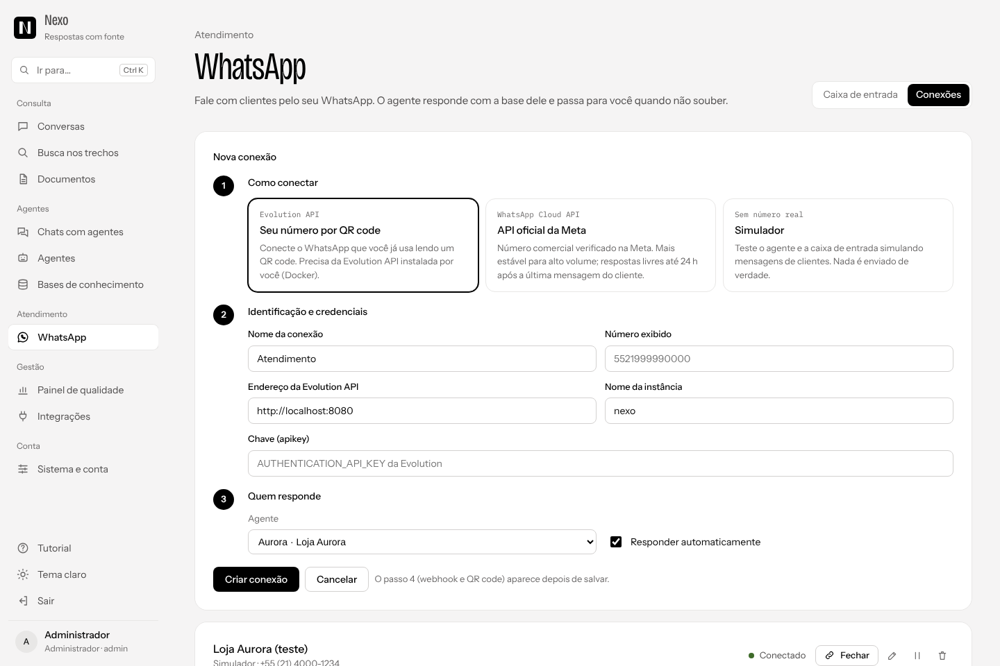
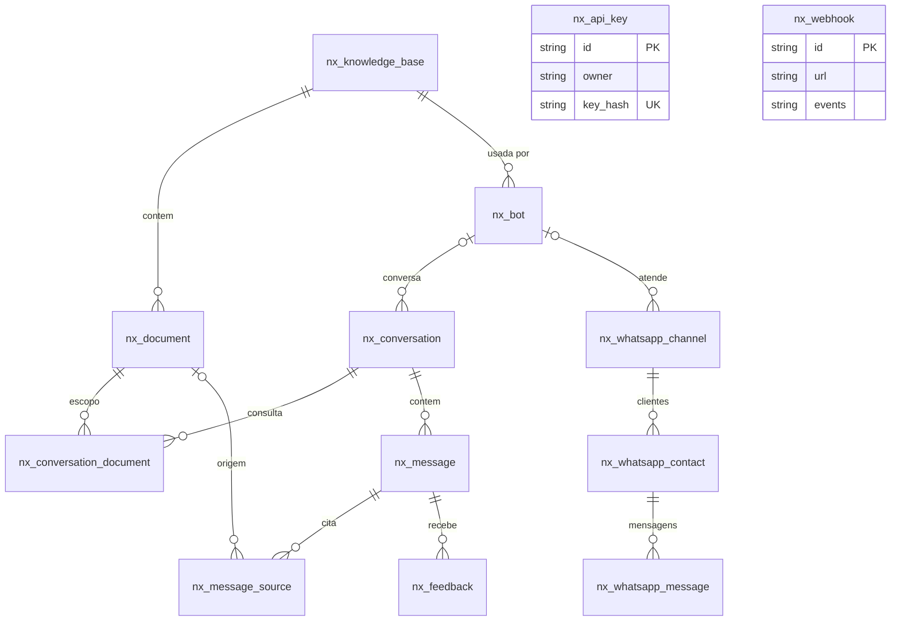

<p align="center">
  
</p>

<h1 align="center">Nexo<br><sub><sup><sup><sub>Copyright (©) 2026 Erik Pimenta</sub></sup></sup></sub></h1>

<p align="center">
  Plataforma de agentes de IA em que cada agente responde só com a própria base de conhecimento (PDF, Word, planilhas, textos e mais)<br>
  e pode atender clientes pelo WhatsApp. Cada resposta cita o trecho e a página de onde saiu. Se a informação não estiver na base, o Nexo diz que não encontrou.
</p>

<p align="center">
  <b>Versão 2.1.0</b><br>
  Python 3.11+ · FastAPI · LlamaIndex · ChromaDB ou Qdrant · Reranking HuggingFace ou Cohere · Ollama ou OpenAI · WhatsApp (Evolution API ou Cloud API) · React 19 · TypeScript
</p>

---

> **Manual completo:** [`Manual-Nexo.pdf`](Manual-Nexo.pdf) explica instalação, configuração, cada tela, os agentes, as bases de conhecimento, o WhatsApp, as integrações, a arquitetura, a API, a avaliação da recuperação e a solução de problemas, passo a passo (cópia em [`docs/`](docs/Manual-Nexo.pdf)).

> **Banco de dados:** [`Banco-de-Dados-Nexo.pdf`](Banco-de-Dados-Nexo.pdf) traz o diagrama de relacionamentos, todas as tabelas com campos, tipos, chaves e restrições (inclusive bases, agentes e WhatsApp), os índices, a migração automática, o banco vetorial, o arquivo de contas, as consultas do painel de qualidade e como trocar o SQLite por outro banco (cópia em [`docs/`](docs/Banco-de-Dados-Nexo.pdf)).

<p align="center">
  
</p>

## Novidades da 2.1

A 2.1.0 transforma o Nexo numa plataforma de agentes, mantendo a identidade visual "caixa única" (a mesma do [Bento](https://github.com/ravelroot/Data-Driven-Admin-Panel)). Tudo o que funcionava na 2.0 continua igual, e bancos antigos são migrados sozinhos.

| | O que mudou |
|---|---|
| **Agentes** | Crie agentes com nome, cor, instruções de tom, saudação e frase para quando não souber. Cada agente usa uma base de conhecimento. |
| **Bases de conhecimento** | Cada base reúne PDF, DOCX, TXT, MD, CSV, JSON e HTML, mais textos digitados na hora. Acrescente ou retire informação quando quiser e mova itens entre bases sem reindexar. |
| **Abas da base** | **Arquivos**, **Textos**, **Testar** (busca só na base) e **Integrar** (exemplos prontos para alimentar a base e perguntar ao agente por outros sistemas). |
| **Vários chats** | Converse com vários agentes ao mesmo tempo, em abas ou até três lado a lado. |
| **WhatsApp** | Caixa de entrada com os clientes: o agente responde sozinho, passa para a equipe quando não sabe, e a equipe assume, devolve ao agente ou pede uma sugestão de resposta. Conexão pela Evolution API (QR code do seu número), pela API oficial da Meta ou pelo simulador. |
| **Tutorial** | Um passo a passo aparece no primeiro acesso e pode ser revisto pela paleta de comandos ou em Sistema e conta. |
| **Integrações** | `/api/ask` e `/api/search` aceitam `bot_id` e `base_id`; webhooks ganharam `whatsapp.message` e `whatsapp.handoff`. |

## O que o Nexo faz

- **Agentes de IA** com instruções, saudação e resposta própria para quando não souber, cada um preso à sua base de conhecimento.
- **Bases de conhecimento** com PDF, DOCX, TXT, MD, CSV, JSON, HTML e textos digitados, editáveis a qualquer hora, com aba para testar a busca e aba para integrar.
- **Chats com vários agentes** em abas ou lado a lado.
- **Atendimento pelo WhatsApp** com resposta automática do agente, passagem para atendente, assumir e devolver a conversa, sugestão de resposta e simulador.
- **Tutorial de primeiro acesso**, guardado por conta.
- **Envio de arquivos** por arrastar e soltar, com fila de indexação, detecção de duplicados por base, filtro, ordenação, renomear, mover, reindexar e excluir.
- **Respostas com base estrita** nos documentos: o modelo recebe só os trechos recuperados e é instruído a citar cada afirmação com `[n]`.
- **Trechos auditáveis**: ao lado da resposta aparecem o documento, a página, a similaridade, a nota do reranker, os termos da pergunta marcados e o botão para abrir o PDF na página certa.
- **Escopo por conversa**: escolha quais documentos cada conversa consulta, ou converse com um agente, que consulta só a base dele.
- **Contexto da conversa**: perguntas como "e o passo seguinte?" são reescritas com o histórico antes da busca.
- **Busca nos trechos** sem LLM, para conferir o que o acervo diz e calibrar perguntas.
- **Painel de qualidade** com as perguntas que ficaram sem resposta, para saber qual PDF falta no acervo.
- **Integrações**: chaves de API, pergunta direta por HTTP, webhooks e exportação de conversas.
- **Contas de acesso** com login pré-definido, cadastro próprio e gestão por administradores, gravadas em `data/usuarios.json` com senhas em bcrypt.
- **Avaliação** de cada resposta (útil / não ajudou) e script de medição de acerto da recuperação.
- **Identidade "caixa única"**, a mesma do [Bento](https://github.com/ravelroot/Data-Driven-Admin-Panel): fundo, menu e cabeçalhos impressos na mesa em `#F5F4F4`, conversa e trechos dividindo paredes finas dentro de uma só caixa branca, resumos na tampa preta, títulos e números em Bricolage Grotesque fina e condensada, textos em Instrument Sans e status como um ponto de cor. Paleta `#FFFFFF`, `#4D4B4B`, `#000000`, `#333232` e `#BAB7B6`.
- **Tema claro, escuro ou automático**, layout responsivo para celular e atalhos de teclado. A logo é sempre em preto e branco.

## Como o Nexo evita alucinações



1. **Dois cortes de relevância** (`NEXO_MIN_SIMILARITY` e `NEXO_MIN_RERANK_SCORE`). Se nenhum trecho passar, o modelo nem é chamado.
2. **Reranking** com cross-encoder: reordena os candidatos da busca vetorial pela relação real com a pergunta e só os `NEXO_TOP_N` melhores seguem.
3. **Prompt estrito** em português: usar só os trechos, citar `[n]`, responder exatamente "Não encontrei essa informação nos documentos selecionados." quando faltar base. As instruções de cada agente entram no prompt, mas não podem mudar essas regras; a frase de quando não souber é trocada pela do agente.
4. **Verificação de fidelidade** opcional (`NEXO_VERIFY_ANSWERS=true`) com o `FaithfulnessEvaluator` do LlamaIndex.
5. **Temperatura baixa** (0,1 por padrão).
6. **Lacunas visíveis**: toda pergunta sem resposta aparece no Painel de qualidade e pode disparar um webhook; no WhatsApp, o contato passa para a equipe.
7. **Base por agente**: cada agente só enxerga os documentos da própria base, o que evita misturar assuntos.

## Como rodar

Pré-requisitos: **Python 3.11 ou mais recente** e **Node.js 20.19 ou mais recente** (só para compilar a interface).

**Windows:** dê dois cliques em `iniciar.cmd`.
**Linux / macOS:** `./iniciar.sh`

Os scripts criam o ambiente virtual, instalam as dependências, copiam `.env.example` para `.env`, compilam a interface e sobem o servidor em **http://127.0.0.1:8000**.

> Atualizando da 2.0? Rode o script de novo: ele percebe que a versão mudou e recompila a interface. O banco existente é migrado sozinho na primeira execução: as tabelas novas são criadas, os documentos antigos vão para a base "Acervo geral" e nenhum vetor precisa ser recalculado.

Manualmente:

```bash
python -m venv .venv
.venv\Scripts\activate          # Windows
source .venv/bin/activate       # Linux / macOS
pip install -r requirements.txt
copy .env.example .env          # Windows  (cp no Linux / macOS)
cd frontend && npm install && npm run build && cd ..
python -m nexo
```

### Escolha um modo

| Modo | O que instalar | `.env` |
|---|---|---|
| **Local e gratuito** (padrão) | [Ollama](https://ollama.com) e `ollama pull llama3.1` | já vem configurado |
| **OpenAI** | uma chave de API | `NEXO_LLM_PROVIDER=openai`, `NEXO_LLM_MODEL=gpt-4o-mini`, `OPENAI_API_KEY=...` |
| **Reranking Cohere** | uma chave de API | `NEXO_RERANKER=cohere`, `COHERE_API_KEY=...` |
| **Qdrant** | Qdrant local ou em nuvem | `NEXO_VECTOR_STORE=qdrant` e, para servidor, `NEXO_QDRANT_URL=...` |
| **Teste sem modelos** | nada | `NEXO_EMBED_PROVIDER=hash`, `NEXO_LLM_PROVIDER=extrativo`, `NEXO_RERANKER=none` |

No modo padrão, o modelo de embeddings (`intfloat/multilingual-e5-small`) e o reranker (`cross-encoder/mmarco-mMiniLMv2-L12-H384-v1`) são baixados do HuggingFace na primeira pergunta e funcionam em CPU.

O modo de teste usa um embedding léxico e devolve as frases mais relevantes dos trechos, sem LLM. Serve para validar a instalação e rodar os testes, não para uso real. As capturas de tela deste README foram feitas nesse modo.

## Login

| Usuário | Senha | Perfil |
|---|---|---|
| `admin` | `Nexo@2026` | Administrador |

Esse é o login pré-definido, criado quando `data/usuarios.json` não existe. Na primeira entrada de cada conta, o tutorial mostra o caminho: base de conhecimento, agente, chats e WhatsApp. Troque a senha em **Sistema e conta** logo no primeiro acesso. Qualquer pessoa pode criar a própria conta na tela de entrada (desligue com `NEXO_ALLOW_REGISTRATION=false`). Esqueceu a senha? Rode `python scripts/redefinir_senha.py <usuario>` no servidor.

## Telas

| | |
|---|---|
|  |  |
| **Tutorial** de primeiro acesso | **Agentes**: cor, base, conversas e situação de cada agente |
|  |  |
| **Chats com agentes** em abas ou lado a lado | **Bases de conhecimento**: resumo na tampa preta e as abas Arquivos, Textos, Testar e Integrar |
|  |  |
| **Textos** escritos direto na base | **Integrar**: exemplos prontos com os ids da base e do agente |
|  |  |
| **WhatsApp**: caixa de entrada com o agente e a equipe | **Conexões**: provedor, agente, webhook e QR code |
|  |  |
| **Entrada** | **Documentos**: todo o acervo, com filtro por base e envio para a base escolhida |
|  |  |
| **Busca nos trechos** com os termos destacados | **Painel de qualidade** com as lacunas do acervo |
|  |  |
| **Integrações**: chaves de API, exemplos e webhooks | **Sistema e conta**: pipeline de respostas, acervo e conta |
|  |  |
| **Sem base nos PDFs**: o Nexo diz que não encontrou e sugere o próximo passo | **Paleta de comandos** (`Ctrl + K`) |
|  |  |
| **Tema escuro** | **Celular** |

### Atalhos

| Tecla | Ação |
|---|---|
| `Ctrl + K` (ou `⌘ + K`) | Abre a paleta de comandos |
| `Enter` | Envia a pergunta e a mensagem do WhatsApp |
| `Shift + Enter` | Quebra a linha na pergunta |
| `↑` `↓` `Enter` `Esc` | Navegam, abrem e fecham a paleta |
| `←` `→` `Esc` | Voltam, avançam e fecham o tutorial |

## Integrações

### Chaves de API

Crie uma chave em **Integrações → Chaves de API**. Ela aparece uma única vez (o servidor guarda só o SHA-256) e tem as mesmas permissões da sua conta. Envie no cabeçalho `X-API-Key` (ou `Authorization: Bearer nxk_...`) para qualquer rota da API.

```bash
curl -X POST http://127.0.0.1:8000/api/ask \
  -H "X-API-Key: nxk_SUA_CHAVE" \
  -H "Content-Type: application/json" \
  -d '{"question": "Qual o torque dos parafusos da tampa?"}'
```

```json
{
  "answer": "Aperte os parafusos da tampa traseira em cruz com torque de 45 N·m [1].",
  "answered": true,
  "grounded": null,
  "model": "ollama:llama3.1",
  "latency_ms": 2140,
  "conversation_id": null,
  "sources": [{ "rank": 1, "document_title": "Guia de Manutenção da Bomba Centrífuga BC-40", "page": 5, "similarity": 0.62, "rerank_score": 0.91, "excerpt": "..." }]
}
```

Sem `conversation_id`, a pergunta não fica gravada. Com ele, o Nexo usa o histórico daquela conversa e grava pergunta e resposta. `document_ids` limita o escopo e `bot_id` faz a pergunta a um agente, com a base e as instruções dele.

### Bases pela API

```bash
curl -X POST http://127.0.0.1:8000/api/bases/ID_DA_BASE/documents \
  -H "X-API-Key: nxk_SUA_CHAVE" -F "files=@tabela-de-precos.csv"

curl -X POST http://127.0.0.1:8000/api/bases/ID_DA_BASE/texts \
  -H "X-API-Key: nxk_SUA_CHAVE" -H "Content-Type: application/json" \
  -d '{"title": "Horário de atendimento", "content": "Segunda a sexta, das 8h às 18h."}'
```

A aba **Integrar** de cada base traz esses exemplos (e a pergunta ao agente) em curl, Python e JavaScript, com os ids preenchidos.

### Webhooks

Administradores cadastram webhooks em **Integrações → Webhooks** e escolhem os eventos:

| Evento | Quando |
|---|---|
| `document.ready` | Um PDF terminou de indexar |
| `document.failed` | A indexação de um PDF falhou |
| `question.unanswered` | Uma pergunta não teve base nos documentos |
| `feedback.negative` | Alguém marcou uma resposta como "não ajudou" |
| `whatsapp.message` | Chegou uma mensagem de cliente no WhatsApp |
| `whatsapp.handoff` | Um contato do WhatsApp passou a aguardar atendente |

Cada entrega é um `POST` em JSON `{"event", "created_at", "data"}` com os cabeçalhos `X-Nexo-Event` e `X-Nexo-Signature: sha256=<hmac>`. Para conferir a assinatura no destino:

```python
import hashlib, hmac

def assinatura_valida(corpo: bytes, cabecalho: str, segredo: str) -> bool:
    esperado = "sha256=" + hmac.new(segredo.encode(), corpo, hashlib.sha256).hexdigest()
    return hmac.compare_digest(esperado, cabecalho)
```

O botão **Testar** envia o evento `ping` e mostra a resposta HTTP do destino. A última entrega (código e erro) fica registrada em cada webhook.

### Exportação

O botão de download no topo de cada conversa gera Markdown (para ler ou colar em documentos) ou JSON (com trechos e notas, para sistemas). Pela API: `GET /api/conversations/{id}/export?format=markdown` ou `format=json`.

## WhatsApp

Em **WhatsApp › Conexões**, um administrador conecta um número e escolhe o agente que atende:

| Provedor | Passo a passo curto |
|---|---|
| **Evolution API** (seu número, QR code) | Tenha um servidor [Evolution API v2](https://doc.evolution-api.com) com uma instância. Informe endereço, chave e instância, clique em **Mostrar QR code** e leia com o WhatsApp do celular (Aparelhos conectados). Depois clique em **Registrar webhook** (usa `NEXO_PUBLIC_URL`). |
| **API oficial (Meta)** | No app da Meta com o produto WhatsApp, copie o Phone Number ID, um token permanente e o app secret para a conexão. Cole a URL do webhook e o verify token mostrados pelo Nexo no app da Meta e assine o campo `messages`. O Nexo confere a assinatura `X-Hub-Signature-256`. |
| **Simulador** | Nada a configurar: use **Simular mensagem de cliente** na caixa de entrada para testar o agente. |

Na **caixa de entrada**, o agente responde sozinho com a base dele. Quando não encontra a resposta, ou quando o cliente pede "atendente", o contato vai para **Aguardando atendente** e o agente pausa nele. Mensagens digitadas no próprio celular do número (Evolution) aparecem como **Pelo celular**, e as confirmações de entrega da API oficial atualizam cada mensagem. Quem responde pela tela assume a conversa; **Devolver ao agente** religa a resposta automática e **Sugerir resposta** traz um rascunho do agente, com as fontes, para revisar antes de enviar. Pela API oficial, respostas livres só valem até 24 horas depois da última mensagem do cliente.

## Configuração

Todas as opções ficam no `.env` (modelo em [`.env.example`](.env.example)). As principais:

| Variável | Padrão | Função |
|---|---|---|
| `NEXO_LLM_PROVIDER` | `ollama` | `ollama`, `openai` ou `extrativo` |
| `NEXO_LLM_MODEL` | `llama3.1` | Modelo de linguagem |
| `NEXO_EMBED_PROVIDER` | `huggingface` | `huggingface`, `openai`, `ollama` ou `hash` |
| `NEXO_EMBED_MODEL` | `intfloat/multilingual-e5-small` | Modelo de embeddings |
| `NEXO_VECTOR_STORE` | `chroma` | `chroma` ou `qdrant` |
| `NEXO_RERANKER` | `huggingface` | `huggingface`, `cohere` ou `none` |
| `NEXO_CHUNK_SIZE` / `NEXO_CHUNK_OVERLAP` | `512` / `64` | Tamanho dos trechos e sobreposição, em tokens |
| `NEXO_TOP_K` / `NEXO_TOP_N` | `12` / `4` | Candidatos da busca e trechos que vão ao modelo |
| `NEXO_MIN_SIMILARITY` | `0.15` | Similaridade mínima de cosseno |
| `NEXO_MIN_RERANK_SCORE` | `0.1` | Nota mínima do reranker |
| `NEXO_VERIFY_ANSWERS` | `false` | Verificação de fidelidade com uma segunda chamada ao LLM |
| `NEXO_WEBHOOK_TIMEOUT` | `5` | Segundos de espera por entrega de webhook |
| `NEXO_PUBLIC_URL` | vazio | Endereço público do Nexo, usado na URL do webhook do WhatsApp |
| `NEXO_WHATSAPP_HISTORY` | `6` | Mensagens anteriores do contato usadas pelo agente no WhatsApp |
| `NEXO_WHATSAPP_TIMEOUT` | `15` | Segundos de espera por chamada ao provedor do WhatsApp |
| `NEXO_MAX_UPLOAD_MB` | `100` | Tamanho máximo de cada arquivo |
| `NEXO_DATABASE_URL` | SQLite em `data/` | Outro banco relacional |
| `NEXO_SECRET` | gerado em `data/.segredo` | Chave de assinatura das sessões |

A tela **Sistema e conta** mostra a configuração ativa.

## Banco de dados

O Nexo cria tudo sozinho na primeira execução e migra bancos da 2.0 sem passo manual. Quem for popular ou administrar os dados encontra em [`Banco-de-Dados-Nexo.pdf`](Banco-de-Dados-Nexo.pdf) (e no resumo em [`docs/banco-de-dados.md`](docs/banco-de-dados.md)) o diagrama de relacionamentos, a função de cada tabela, o formato do banco vetorial e do arquivo de usuários, e como trocar o SQLite por PostgreSQL, MySQL ou SQL Server. O DDL está em [`docs/schema-postgresql.sql`](docs/schema-postgresql.sql) e [`docs/schema-sqlite.sql`](docs/schema-sqlite.sql).



`nx_api_key` e `nx_webhook` ligam-se às contas pelo nome de usuário (as contas ficam em `data/usuarios.json`, fora do banco). Os agentes não têm coleção vetorial própria: a busca filtra pelos documentos da base de cada um, por isso mover itens entre bases não exige reindexar.

## Estrutura

```
nexo/
  config.py          configuração lida do .env
  db.py              tabelas SQLAlchemy
  migrations.py      migração automática de bancos da 2.0
  knowledge.py       leitura de DOCX, TXT, MD, CSV, JSON, HTML e textos
  whatsapp.py        provedores, webhook, contatos e respostas do agente no WhatsApp
  users.py           contas em data/usuarios.json
  security.py        tokens JWT e chaves de API
  jobs.py            fila de indexação
  webhooks.py        entrega assinada dos eventos
  rag/
    engine.py        leitura dos PDFs, indexação, busca, reranking, prompt do agente e resposta
    providers.py     LLM, embeddings, banco vetorial e reranker configuráveis
    hash_embedding.py  embedding léxico para testes
  api/               rotas FastAPI, esquemas e autenticação (agents.py: bases e agentes; whatsapp.py: WhatsApp)
frontend/            interface React + TypeScript (Vite)
  src/pages/         Entrada, Conversas, Chats, Agents, Bases, WhatsApp, Busca, Documentos, Painel, Integrações, Sistema
  src/components/    menu, Tutorial, paleta de comandos, trechos com termos destacados
scripts/             avaliação da recuperação, PDF de exemplo, redefinição de senha
exemplos/            PDF fictício e perguntas de avaliação
docs/                manuais em PDF, banco de dados, DDL e imagens
tests/               testes automatizados
```

## API

Documentação interativa em **http://127.0.0.1:8000/api/docs**. Todas as rotas, exceto entrada, cadastro e o webhook público do WhatsApp, exigem `Authorization: Bearer <token>` ou uma chave de API.

| Método | Rota | Função |
|---|---|---|
| POST | `/api/auth/login` · `/api/auth/register` | Entrar e criar conta |
| PUT | `/api/auth/password` | Trocar senha |
| PUT | `/api/auth/tutorial` | Marcar o tutorial como visto ou para rever |
| GET / POST | `/api/bases` | Listar e criar bases de conhecimento |
| GET / PATCH / DELETE | `/api/bases/{id}` | Abrir, renomear e excluir base |
| GET / POST | `/api/bases/{id}/documents` | Listar itens e enviar arquivos para a base |
| POST | `/api/bases/{id}/texts` | Criar um texto na base |
| GET / PUT | `/api/documents/{id}/text` | Ler e editar um texto |
| GET / POST | `/api/bots` | Listar e criar agentes |
| GET / PATCH / DELETE | `/api/bots/{id}` | Abrir, editar e excluir agente |
| GET / POST | `/api/documents` | Listar e enviar PDFs |
| PATCH / DELETE | `/api/documents/{id}` | Renomear, mover de base (`base_id`) e excluir |
| POST | `/api/documents/{id}/reindex` | Reindexar |
| GET | `/api/documents/{id}/file` | Baixar o PDF |
| GET / POST | `/api/conversations` | Listar (filtros `only` e `bot_id`) e criar conversas (`bot_id` opcional) |
| POST | `/api/conversations/{id}/messages` | Perguntar |
| GET | `/api/conversations/{id}/export` | Exportar em Markdown ou JSON |
| POST | `/api/messages/{id}/feedback` | Avaliar resposta |
| POST | `/api/ask` | Pergunta direta, para integrações (`bot_id` opcional) |
| POST | `/api/search` | Busca nos trechos, sem LLM (`base_id` opcional) |
| GET | `/api/metrics?days=30` | Painel de qualidade |
| GET / POST / DELETE | `/api/keys` · `/api/keys/{id}` | Chaves de API |
| GET / POST / PATCH / DELETE | `/api/webhooks` · `/api/webhooks/{id}` | Webhooks (administrador) |
| POST | `/api/webhooks/{id}/test` | Entrega de teste |
| GET / PATCH / DELETE | `/api/users` · `/api/users/{usuario}` | Contas (administrador) |
| GET / POST / PATCH / DELETE | `/api/whatsapp/channels` · `/api/whatsapp/channels/{id}` | Conexões do WhatsApp (administrador para alterar) |
| GET | `/api/whatsapp/channels/{id}/status` · `/qrcode` | Situação da conexão e QR code da Evolution |
| POST | `/api/whatsapp/channels/{id}/webhook` · `/simulate` | Registrar webhook e simular mensagem de cliente |
| GET / POST | `/api/whatsapp/webhook/{id}` | Webhook público chamado pelo WhatsApp |
| GET | `/api/whatsapp/summary` · `/api/whatsapp/contacts` | Números da caixa de entrada e contatos |
| GET / PATCH | `/api/whatsapp/contacts/{id}` | Conversa com o cliente; ligar ou pausar o agente |
| POST | `/api/whatsapp/contacts/{id}/messages` · `/suggest` | Responder como a equipe e pedir sugestão ao agente |
| GET | `/api/system/status` | Configuração e números do acervo |

## Avaliar a recuperação

Monte um arquivo JSONL com perguntas e a página que deveria ser encontrada (veja [`exemplos/perguntas-exemplo.jsonl`](exemplos/perguntas-exemplo.jsonl)) e rode:

```bash
python scripts/avaliar.py exemplos/perguntas-exemplo.jsonl --detalhes
```

O script mostra o acerto e o MRR da busca vetorial pura e com reranking, para calibrar `NEXO_TOP_K`, `NEXO_TOP_N` e os cortes de relevância. A tela **Busca nos trechos** faz a mesma conferência pergunta a pergunta.

## Testes

```bash
pip install -r requirements-ci.txt
python -m pytest
```

Os testes usam o modo sem modelos e cobrem bases de conhecimento e formatos novos, textos, mover entre bases, agentes, conversas com agentes, migração de um banco da 2.0, tutorial, WhatsApp (simulador, webhook da Meta com assinatura, Evolution com token, envio, passagem para atendente e sugestão), autenticação, bloqueio por tentativas, cadastro em arquivo, envio e indexação de PDF, respostas com fontes, pergunta fora do conteúdo, escopo, reranking, permissões, exclusão de vetores, busca nos trechos, exportação, painel de qualidade, chaves de API, pergunta direta, webhooks com assinatura e gestão de contas.

## Licença

[MIT](LICENSE). Use, copie, altere e distribua à vontade. As fontes [Instrument Sans](https://fonts.google.com/specimen/Instrument+Sans), [Bricolage Grotesque](https://fonts.google.com/specimen/Bricolage+Grotesque) e [IBM Plex Mono](https://www.ibm.com/plex/) da interface vêm do [Fontsource](https://fontsource.org/) e são distribuídas sob a SIL Open Font License 1.1.
