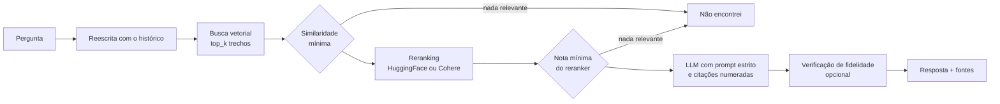
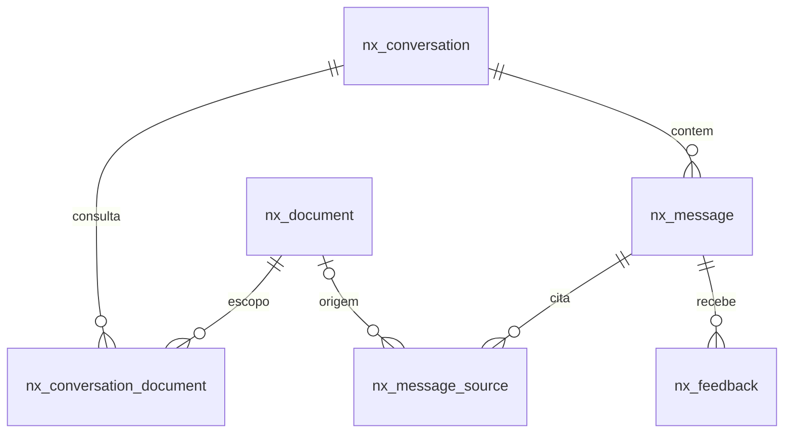

<p align="center">
  
</p>

<h1 align="center">Nexo<br><sub><sup><sup><sub>Copyright (©) 2026 Erik Pimenta</sub></sup></sup></sub></h1>

<p align="center">
  Chatbot que responde dúvidas sobre manuais técnicos e livros em PDF usando somente o conteúdo dos documentos enviados.<br>
  Cada resposta cita o trecho e a página de onde saiu. Se a informação não estiver nos PDFs, o Nexo diz que não encontrou.
</p>

<p align="center">
  Python 3.11+ · FastAPI · LlamaIndex · ChromaDB ou Qdrant · Reranking HuggingFace ou Cohere · Ollama ou OpenAI · React 19 · TypeScript
</p>

---

> **Manual completo:** [`Manual-Nexo.pdf`](Manual-Nexo.pdf) explica instalação, configuração, arquitetura, cada tela, a API, a avaliação da recuperação e a solução de problemas, passo a passo (cópia em [`docs/`](docs/Manual-Nexo.pdf)).

> **Banco de dados:** [`Banco-de-Dados-Nexo.pdf`](Banco-de-Dados-Nexo.pdf) traz o diagrama de relacionamentos, todas as tabelas com campos, tipos, chaves e restrições, os índices, o banco vetorial, o arquivo de contas, as decisões de arquitetura e como trocar o SQLite por outro banco (cópia em [`docs/`](docs/Banco-de-Dados-Nexo.pdf)).

<p align="center">
  
</p>

## O que o Nexo faz

- **Envio de PDFs** por arrastar e soltar, com fila de indexação, detecção de duplicados, renomear, reindexar e excluir.
- **Respostas com base estrita** nos documentos: o modelo recebe só os trechos recuperados e é instruído a citar cada afirmação com `[n]`.
- **Trechos auditáveis**: ao lado da resposta aparecem o documento, a página, a similaridade, a nota do reranker e o botão para abrir o PDF na página certa.
- **Escopo por conversa**: escolha quais documentos cada conversa consulta.
- **Contexto da conversa**: perguntas como "e o passo seguinte?" são reescritas com o histórico antes da busca.
- **Contas de acesso** com login pré-definido e cadastro próprio, gravadas em `data/usuarios.json` com senhas em bcrypt.
- **Avaliação** de cada resposta (útil / não ajudou) e script de medição de acerto da recuperação.
- **Identidade "caixa única"**, a mesma do [Bento](https://github.com/ravelroot/Data-Driven-Admin-Panel): fundo, menu e cabeçalhos impressos na mesa em `#F5F4F4`, conversa e trechos dividindo paredes finas dentro de uma só caixa branca, resumo do acervo na tampa preta, títulos e números em Bricolage Grotesque fina e condensada, textos em Instrument Sans e status como um ponto de cor. Paleta `#FFFFFF`, `#4D4B4B`, `#000000`, `#333232` e `#BAB7B6`.
- **Tema claro e escuro**, layout responsivo para celular. A logo é sempre em preto e branco.

## Como o Nexo evita alucinações



1. **Dois cortes de relevância** (`NEXO_MIN_SIMILARITY` e `NEXO_MIN_RERANK_SCORE`). Se nenhum trecho passar, o modelo nem é chamado.
2. **Reranking** com cross-encoder: reordena os candidatos da busca vetorial pela relação real com a pergunta e só os `NEXO_TOP_N` melhores seguem.
3. **Prompt estrito** em português: usar só os trechos, citar `[n]`, responder exatamente "Não encontrei essa informação nos documentos selecionados." quando faltar base.
4. **Verificação de fidelidade** opcional (`NEXO_VERIFY_ANSWERS=true`) com o `FaithfulnessEvaluator` do LlamaIndex.
5. **Temperatura baixa** (0,1 por padrão).

## Como rodar

Pré-requisitos: **Python 3.11 ou mais recente** e **Node.js 20.19 ou mais recente** (só para compilar a interface).

**Windows:** dê dois cliques em `iniciar.cmd`.
**Linux / macOS:** `./iniciar.sh`

Os scripts criam o ambiente virtual, instalam as dependências, copiam `.env.example` para `.env`, compilam a interface e sobem o servidor em **http://127.0.0.1:8000**.

Manualmente:

```bash
python -m venv .venv
.venv\Scripts\activate          # Windows
source .venv/bin/activate       # Linux / macOS
pip install -r requirements.txt
copy .env.example .env          # Windows  (cp no Linux / macOS)
cd frontend && npm install && npm run build && cd ..
python -m nexo
```

### Escolha um modo

| Modo | O que instalar | `.env` |
|---|---|---|
| **Local e gratuito** (padrão) | [Ollama](https://ollama.com) e `ollama pull llama3.1` | já vem configurado |
| **OpenAI** | uma chave de API | `NEXO_LLM_PROVIDER=openai`, `NEXO_LLM_MODEL=gpt-4o-mini`, `OPENAI_API_KEY=...` |
| **Reranking Cohere** | uma chave de API | `NEXO_RERANKER=cohere`, `COHERE_API_KEY=...` |
| **Qdrant** | Qdrant local ou em nuvem | `NEXO_VECTOR_STORE=qdrant` e, para servidor, `NEXO_QDRANT_URL=...` |
| **Teste sem modelos** | nada | `NEXO_EMBED_PROVIDER=hash`, `NEXO_LLM_PROVIDER=extrativo`, `NEXO_RERANKER=none` |

No modo padrão, o modelo de embeddings (`intfloat/multilingual-e5-small`) e o reranker (`cross-encoder/mmarco-mMiniLMv2-L12-H384-v1`) são baixados do HuggingFace na primeira pergunta e funcionam em CPU.

O modo de teste usa um embedding léxico e devolve as frases mais relevantes dos trechos, sem LLM. Serve para validar a instalação e rodar os testes, não para uso real.

## Login

| Usuário | Senha | Perfil |
|---|---|---|
| `admin` | `Nexo@2026` | Administrador |

Esse é o login pré-definido, criado quando `data/usuarios.json` não existe. Troque a senha em **Sistema e conta** logo no primeiro acesso. Qualquer pessoa pode criar a própria conta na tela de entrada (desligue com `NEXO_ALLOW_REGISTRATION=false`). Esqueceu a senha? Rode `python scripts/redefinir_senha.py <usuario>` no servidor.

| Tela | |
|---|---|
|  |  |
|  |  |

## Configuração

Todas as opções ficam no `.env` (modelo em [`.env.example`](.env.example)). As principais:

| Variável | Padrão | Função |
|---|---|---|
| `NEXO_LLM_PROVIDER` | `ollama` | `ollama`, `openai` ou `extrativo` |
| `NEXO_LLM_MODEL` | `llama3.1` | Modelo de linguagem |
| `NEXO_EMBED_PROVIDER` | `huggingface` | `huggingface`, `openai`, `ollama` ou `hash` |
| `NEXO_EMBED_MODEL` | `intfloat/multilingual-e5-small` | Modelo de embeddings |
| `NEXO_VECTOR_STORE` | `chroma` | `chroma` ou `qdrant` |
| `NEXO_RERANKER` | `huggingface` | `huggingface`, `cohere` ou `none` |
| `NEXO_CHUNK_SIZE` / `NEXO_CHUNK_OVERLAP` | `512` / `64` | Tamanho dos trechos e sobreposição, em tokens |
| `NEXO_TOP_K` / `NEXO_TOP_N` | `12` / `4` | Candidatos da busca e trechos que vão ao modelo |
| `NEXO_MIN_SIMILARITY` | `0.15` | Similaridade mínima de cosseno |
| `NEXO_MIN_RERANK_SCORE` | `0.1` | Nota mínima do reranker |
| `NEXO_VERIFY_ANSWERS` | `false` | Verificação de fidelidade com uma segunda chamada ao LLM |
| `NEXO_DATABASE_URL` | SQLite em `data/` | Outro banco relacional |
| `NEXO_SECRET` | gerado em `data/.segredo` | Chave de assinatura das sessões |

A tela **Sistema e conta** mostra a configuração ativa.

<p align="center">
  
</p>

## Banco de dados

O Nexo cria tudo sozinho na primeira execução. Quem for popular ou administrar os dados encontra em [`Banco-de-Dados-Nexo.pdf`](Banco-de-Dados-Nexo.pdf) (e no resumo em [`docs/banco-de-dados.md`](docs/banco-de-dados.md)) o diagrama de relacionamentos, a função de cada tabela, o formato do banco vetorial e do arquivo de usuários, e como trocar o SQLite por PostgreSQL, MySQL ou SQL Server. O DDL está em [`docs/schema-postgresql.sql`](docs/schema-postgresql.sql) e [`docs/schema-sqlite.sql`](docs/schema-sqlite.sql).



## Estrutura

```
nexo/
  config.py          configuração lida do .env
  db.py              tabelas SQLAlchemy
  users.py           contas em data/usuarios.json
  security.py        tokens JWT
  jobs.py            fila de indexação
  rag/
    engine.py        leitura dos PDFs, indexação, busca, reranking e resposta
    providers.py     LLM, embeddings, banco vetorial e reranker configuráveis
    hash_embedding.py  embedding léxico para testes
  api/               rotas FastAPI, esquemas e autenticação
frontend/            interface React + TypeScript (Vite)
scripts/             avaliação da recuperação, PDF de exemplo, redefinição de senha
exemplos/            PDF fictício e perguntas de avaliação
docs/                manuais em PDF, banco de dados, DDL e imagens
tests/               testes automatizados
```

## API

Documentação interativa em **http://127.0.0.1:8000/api/docs**. Todas as rotas, exceto entrada e cadastro, exigem `Authorization: Bearer <token>`.

| Método | Rota | Função |
|---|---|---|
| POST | `/api/auth/login` · `/api/auth/register` | Entrar e criar conta |
| PUT | `/api/auth/password` | Trocar senha |
| GET / POST | `/api/documents` | Listar e enviar PDFs |
| PATCH / DELETE | `/api/documents/{id}` | Renomear e excluir |
| POST | `/api/documents/{id}/reindex` | Reindexar |
| GET | `/api/documents/{id}/file` | Baixar o PDF |
| GET / POST | `/api/conversations` | Listar e criar conversas |
| POST | `/api/conversations/{id}/messages` | Perguntar |
| POST | `/api/messages/{id}/feedback` | Avaliar resposta |
| GET | `/api/system/status` | Configuração e números do acervo |

## Avaliar a recuperação

Monte um arquivo JSONL com perguntas e a página que deveria ser encontrada (veja [`exemplos/perguntas-exemplo.jsonl`](exemplos/perguntas-exemplo.jsonl)) e rode:

```bash
python scripts/avaliar.py exemplos/perguntas-exemplo.jsonl --detalhes
```

O script mostra o acerto e o MRR da busca vetorial pura e com reranking, para calibrar `NEXO_TOP_K`, `NEXO_TOP_N` e os cortes de relevância.

## Testes

```bash
pip install -r requirements-ci.txt
python -m pytest
```

Os testes usam o modo sem modelos e cobrem autenticação, bloqueio por tentativas, cadastro em arquivo, envio e indexação de PDF, respostas com fontes, pergunta fora do conteúdo, escopo, reranking, permissões e exclusão de vetores.

## Licença

[MIT](LICENSE). Use, copie, altere e distribua à vontade. As fontes [Instrument Sans](https://fonts.google.com/specimen/Instrument+Sans), [Bricolage Grotesque](https://fonts.google.com/specimen/Bricolage+Grotesque) e [IBM Plex Mono](https://www.ibm.com/plex/) da interface vêm do [Fontsource](https://fontsource.org/) e são distribuídas sob a SIL Open Font License 1.1.
