<p align="center">
  
</p>

<h1 align="center">Nexo<br><sub><sup><sup><sub>Copyright (©) 2026 Erik Pimenta</sub></sup></sup></sub></h1>

<p align="center">
  Chatbot que responde dúvidas sobre manuais técnicos e livros em PDF usando somente o conteúdo dos documentos enviados.<br>
  Cada resposta cita o trecho e a página de onde saiu. Se a informação não estiver nos PDFs, o Nexo diz que não encontrou.
</p>

<p align="center">
  <b>Versão 2.0.0</b><br>
  Python 3.11+ · FastAPI · LlamaIndex · ChromaDB ou Qdrant · Reranking HuggingFace ou Cohere · Ollama ou OpenAI · React 19 · TypeScript
</p>

---

> **Manual completo:** [`Manual-Nexo.pdf`](Manual-Nexo.pdf) explica instalação, configuração, cada tela, as integrações, a arquitetura, a API, a avaliação da recuperação e a solução de problemas, passo a passo (cópia em [`docs/`](docs/Manual-Nexo.pdf)).

> **Banco de dados:** [`Banco-de-Dados-Nexo.pdf`](Banco-de-Dados-Nexo.pdf) traz o diagrama de relacionamentos, todas as tabelas com campos, tipos, chaves e restrições, os índices, o banco vetorial, o arquivo de contas, as consultas do painel de qualidade e como trocar o SQLite por outro banco (cópia em [`docs/`](docs/Banco-de-Dados-Nexo.pdf)).

<p align="center">
  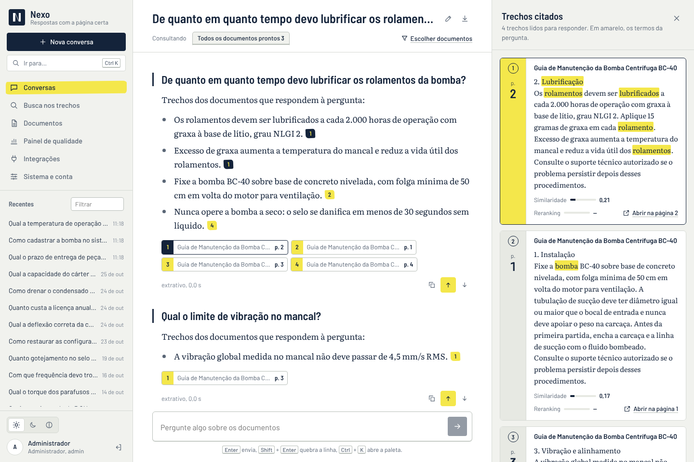
</p>

## Novidades da 2.0

| | O que mudou |
|---|---|
| **Nova identidade** | Visual de "manual de bancada": papel, tinta azul-marinho e marca-texto amarelo nas citações e nos termos encontrados. Perguntas em Barlow Semi Condensed, respostas e trechos em Literata, uma serifa feita para leitura longa. |
| **Busca nos trechos** | Encontra a passagem exata sem gerar resposta, com escolha de documento, quantidade de resultados e reranking ligado ou desligado. |
| **Painel de qualidade** | Taxa de resposta, tempo médio e p95, avaliações, perguntas por dia, documentos mais citados e as **lacunas do acervo** (perguntas que nenhum PDF respondeu). |
| **Integrações** | Chaves de API pessoais, rota `POST /api/ask` para outros sistemas, exemplos prontos em curl, Python e JavaScript e **webhooks** assinados com HMAC SHA-256. |
| **Exportação** | Cada conversa sai em Markdown ou JSON, com as fontes e as notas de relevância. |
| **Trechos com marca-texto** | O painel de trechos destaca em amarelo os termos da pergunta dentro de cada passagem citada. |
| **Paleta de comandos** | `Ctrl + K` abre conversas, telas e "perguntar a um documento" pelo teclado. |
| **Gestão de contas** | Administradores promovem, rebaixam e excluem contas pela tela Sistema e conta. |
| **Mais conforto** | Conversas recentes na barra lateral com filtro, copiar resposta com as fontes, filtro e ordenação de documentos, tema claro, escuro ou automático. |

## O que o Nexo faz

- **Envio de PDFs** por arrastar e soltar, com fila de indexação, detecção de duplicados, filtro, ordenação, renomear, reindexar e excluir.
- **Respostas com base estrita** nos documentos: o modelo recebe só os trechos recuperados e é instruído a citar cada afirmação com `[n]`.
- **Trechos auditáveis**: ao lado da resposta aparecem o documento, a página, a similaridade, a nota do reranker, os termos da pergunta marcados e o botão para abrir o PDF na página certa.
- **Escopo por conversa**: escolha quais documentos cada conversa consulta, ou comece uma conversa direto de um documento.
- **Contexto da conversa**: perguntas como "e o passo seguinte?" são reescritas com o histórico antes da busca.
- **Busca nos trechos** sem LLM, para conferir o que o acervo diz e calibrar perguntas.
- **Painel de qualidade** com as perguntas que ficaram sem resposta, para saber qual PDF falta no acervo.
- **Integrações**: chaves de API, pergunta direta por HTTP, webhooks e exportação de conversas.
- **Contas de acesso** com login pré-definido, cadastro próprio e gestão por administradores, gravadas em `data/usuarios.json` com senhas em bcrypt.
- **Avaliação** de cada resposta (útil / não ajudou) e script de medição de acerto da recuperação.
- **Tema claro, escuro ou automático**, layout responsivo para celular e atalhos de teclado. A logo é sempre de uma cor só.

## Como o Nexo evita alucinações

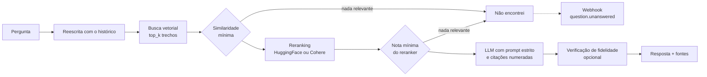

1. **Dois cortes de relevância** (`NEXO_MIN_SIMILARITY` e `NEXO_MIN_RERANK_SCORE`). Se nenhum trecho passar, o modelo nem é chamado.
2. **Reranking** com cross-encoder: reordena os candidatos da busca vetorial pela relação real com a pergunta e só os `NEXO_TOP_N` melhores seguem.
3. **Prompt estrito** em português: usar só os trechos, citar `[n]`, responder exatamente "Não encontrei essa informação nos documentos selecionados." quando faltar base.
4. **Verificação de fidelidade** opcional (`NEXO_VERIFY_ANSWERS=true`) com o `FaithfulnessEvaluator` do LlamaIndex.
5. **Temperatura baixa** (0,1 por padrão).
6. **Lacunas visíveis**: toda pergunta sem resposta aparece no Painel de qualidade e pode disparar um webhook.

## Como rodar

Pré-requisitos: **Python 3.11 ou mais recente** e **Node.js 20.19 ou mais recente** (só para compilar a interface).

**Windows:** dê dois cliques em `iniciar.cmd`.
**Linux / macOS:** `./iniciar.sh`

Os scripts criam o ambiente virtual, instalam as dependências, copiam `.env.example` para `.env`, compilam a interface e sobem o servidor em **http://127.0.0.1:8000**.

> Atualizando da 1.x? Rode o script de novo: ele percebe que a versão mudou e recompila a interface. O banco existente continua valendo: as tabelas novas (`nx_api_key` e `nx_webhook`) são criadas sozinhas na primeira execução.

Manualmente:

```bash
python -m venv .venv
.venv\Scripts\activate          # Windows
source .venv/bin/activate       # Linux / macOS
pip install -r requirements.txt
copy .env.example .env          # Windows  (cp no Linux / macOS)
cd frontend && npm install && npm run build && cd ..
python -m nexo
```

### Escolha um modo

| Modo | O que instalar | `.env` |
|---|---|---|
| **Local e gratuito** (padrão) | [Ollama](https://ollama.com) e `ollama pull llama3.1` | já vem configurado |
| **OpenAI** | uma chave de API | `NEXO_LLM_PROVIDER=openai`, `NEXO_LLM_MODEL=gpt-4o-mini`, `OPENAI_API_KEY=...` |
| **Reranking Cohere** | uma chave de API | `NEXO_RERANKER=cohere`, `COHERE_API_KEY=...` |
| **Qdrant** | Qdrant local ou em nuvem | `NEXO_VECTOR_STORE=qdrant` e, para servidor, `NEXO_QDRANT_URL=...` |
| **Teste sem modelos** | nada | `NEXO_EMBED_PROVIDER=hash`, `NEXO_LLM_PROVIDER=extrativo`, `NEXO_RERANKER=none` |

No modo padrão, o modelo de embeddings (`intfloat/multilingual-e5-small`) e o reranker (`cross-encoder/mmarco-mMiniLMv2-L12-H384-v1`) são baixados do HuggingFace na primeira pergunta e funcionam em CPU.

O modo de teste usa um embedding léxico e devolve as frases mais relevantes dos trechos, sem LLM. Serve para validar a instalação e rodar os testes, não para uso real. As capturas de tela deste README foram feitas nesse modo.

## Login

| Usuário | Senha | Perfil |
|---|---|---|
| `admin` | `Nexo@2026` | Administrador |

Esse é o login pré-definido, criado quando `data/usuarios.json` não existe. Troque a senha em **Sistema e conta** logo no primeiro acesso. Qualquer pessoa pode criar a própria conta na tela de entrada (desligue com `NEXO_ALLOW_REGISTRATION=false`). Esqueceu a senha? Rode `python scripts/redefinir_senha.py <usuario>` no servidor.

## Telas

| | |
|---|---|
| 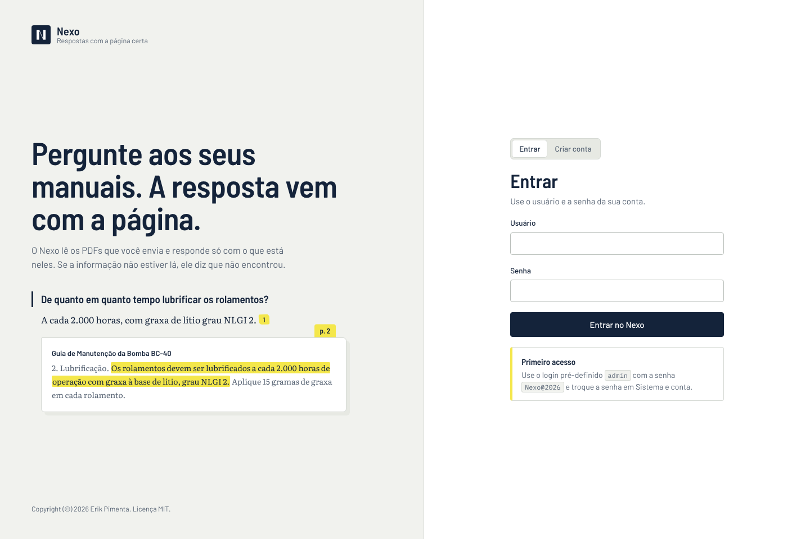 | 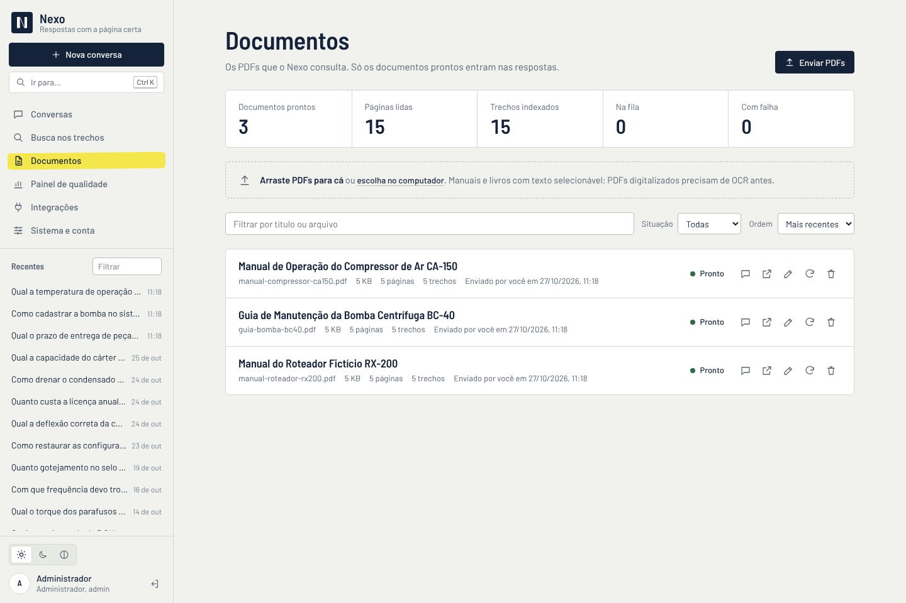 |
| **Entrada**, com um exemplo real de resposta citada | **Documentos**: resumo do acervo, envio, filtro e ordenação |
| 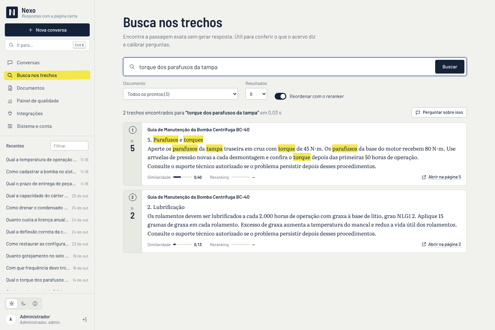 | 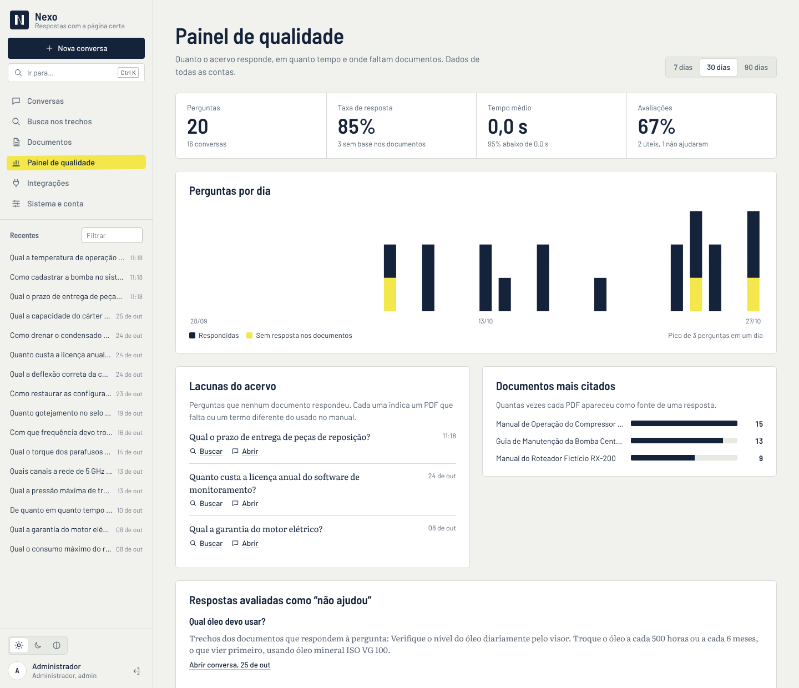 |
| **Busca nos trechos** com os termos marcados | **Painel de qualidade** com as lacunas do acervo |
| 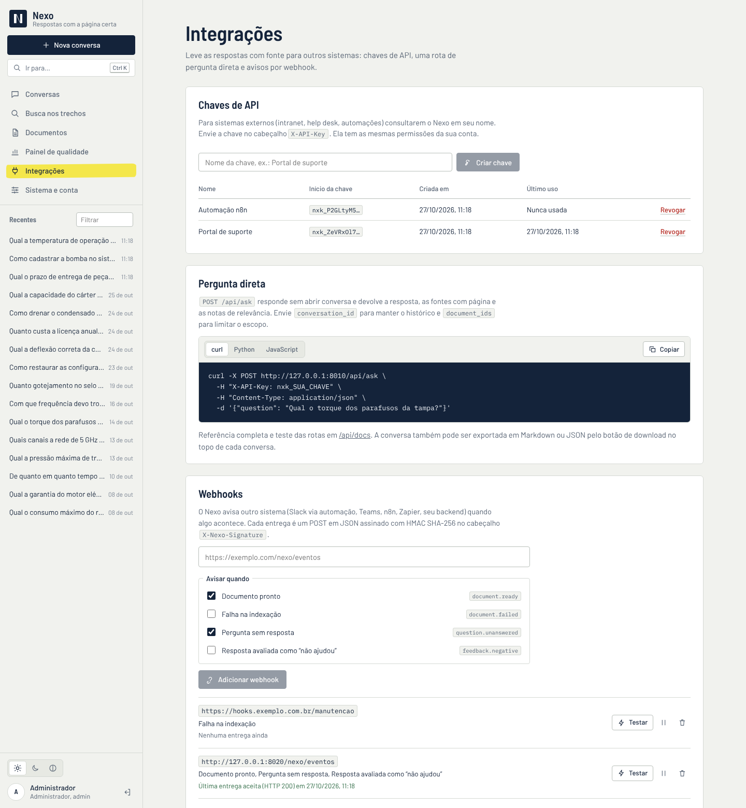 | 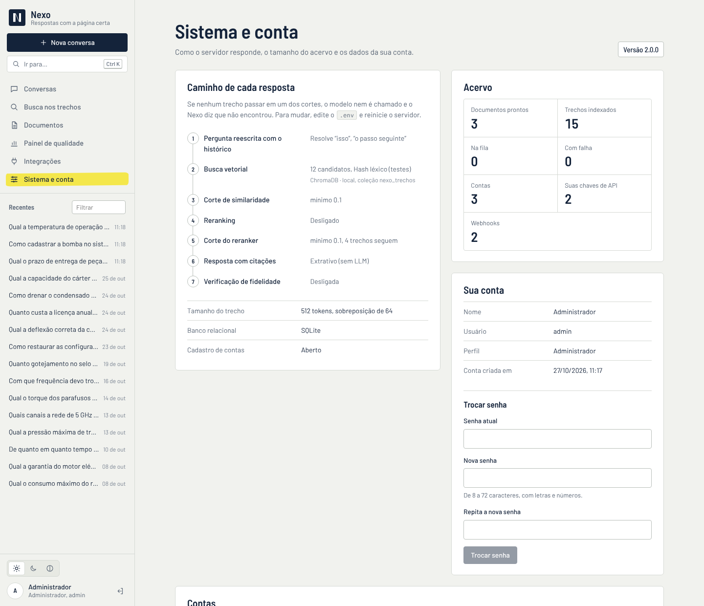 |
| **Integrações**: chaves de API, exemplos e webhooks | **Sistema e conta**: o caminho de cada resposta e as contas |
| 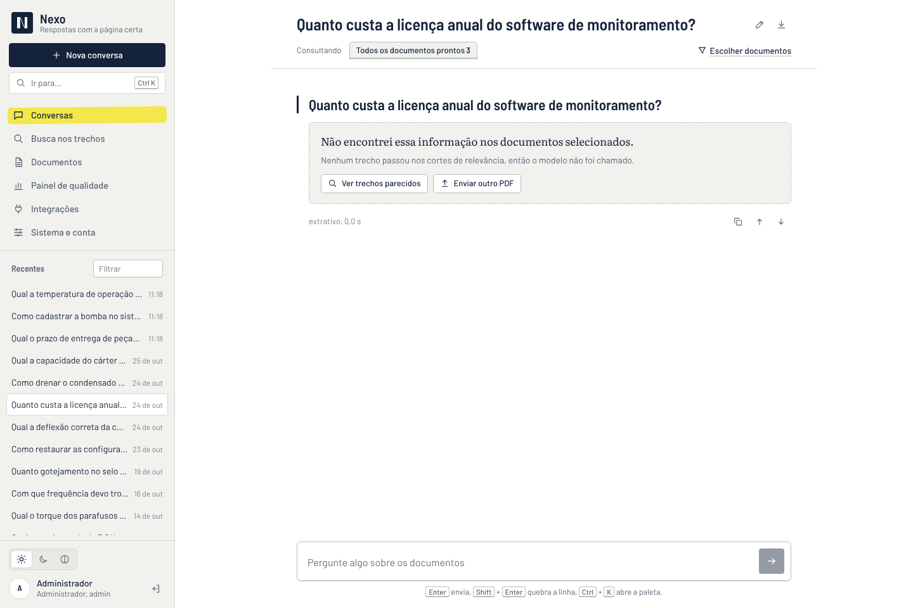 | 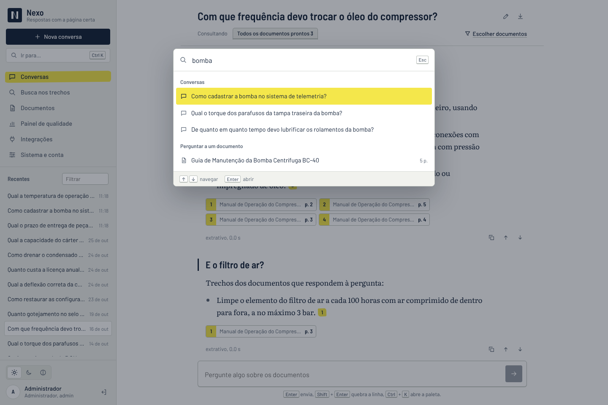 |
| **Sem base nos PDFs**: o Nexo diz que não encontrou e sugere o próximo passo | **Paleta de comandos** (`Ctrl + K`) |
| 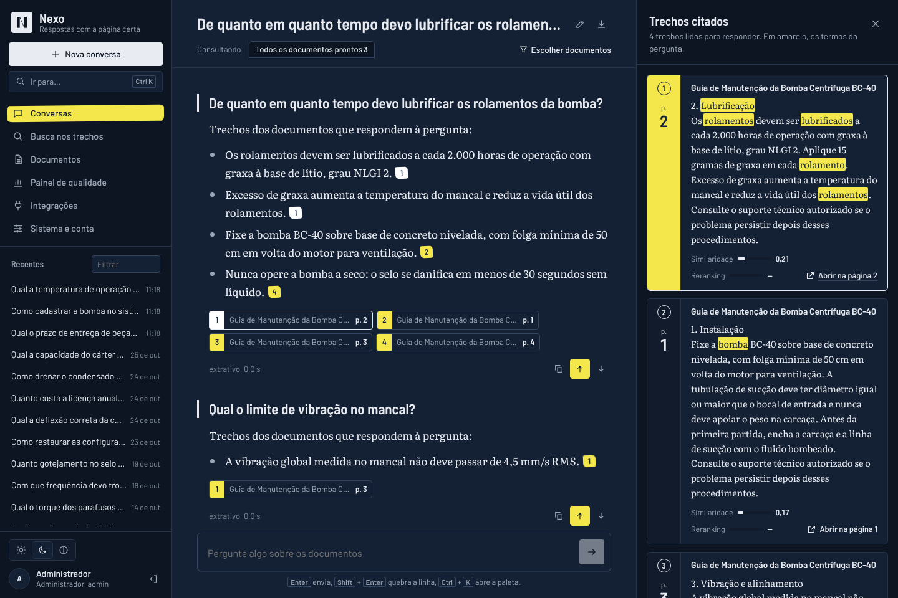 | 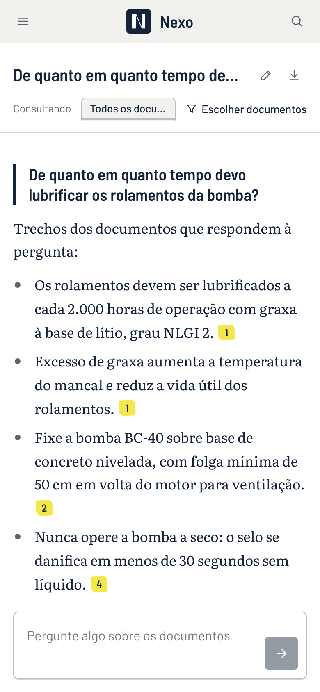 |
| **Tema escuro** | **Celular** |

### Atalhos

| Tecla | Ação |
|---|---|
| `Ctrl + K` (ou `⌘ + K`) | Abre a paleta de comandos |
| `Enter` | Envia a pergunta |
| `Shift + Enter` | Quebra a linha na pergunta |
| `↑` `↓` `Enter` `Esc` | Navegam, abrem e fecham a paleta |

## Integrações

### Chaves de API

Crie uma chave em **Integrações → Chaves de API**. Ela aparece uma única vez (o servidor guarda só o SHA-256) e tem as mesmas permissões da sua conta. Envie no cabeçalho `X-API-Key` (ou `Authorization: Bearer nxk_...`) para qualquer rota da API.

```bash
curl -X POST http://127.0.0.1:8000/api/ask \
  -H "X-API-Key: nxk_SUA_CHAVE" \
  -H "Content-Type: application/json" \
  -d '{"question": "Qual o torque dos parafusos da tampa?"}'
```

```json
{
  "answer": "Aperte os parafusos da tampa traseira em cruz com torque de 45 N·m [1].",
  "answered": true,
  "grounded": null,
  "model": "ollama:llama3.1",
  "latency_ms": 2140,
  "conversation_id": null,
  "sources": [{ "rank": 1, "document_title": "Guia de Manutenção da Bomba Centrífuga BC-40", "page": 5, "similarity": 0.62, "rerank_score": 0.91, "excerpt": "..." }]
}
```

Sem `conversation_id`, a pergunta não fica gravada. Com ele, o Nexo usa o histórico daquela conversa e grava pergunta e resposta. `document_ids` limita o escopo.

### Webhooks

Administradores cadastram webhooks em **Integrações → Webhooks** e escolhem os eventos:

| Evento | Quando |
|---|---|
| `document.ready` | Um PDF terminou de indexar |
| `document.failed` | A indexação de um PDF falhou |
| `question.unanswered` | Uma pergunta não teve base nos documentos |
| `feedback.negative` | Alguém marcou uma resposta como "não ajudou" |

Cada entrega é um `POST` em JSON `{"event", "created_at", "data"}` com os cabeçalhos `X-Nexo-Event` e `X-Nexo-Signature: sha256=<hmac>`. Para conferir a assinatura no destino:

```python
import hashlib, hmac

def assinatura_valida(corpo: bytes, cabecalho: str, segredo: str) -> bool:
    esperado = "sha256=" + hmac.new(segredo.encode(), corpo, hashlib.sha256).hexdigest()
    return hmac.compare_digest(esperado, cabecalho)
```

O botão **Testar** envia o evento `ping` e mostra a resposta HTTP do destino. A última entrega (código e erro) fica registrada em cada webhook.

### Exportação

O botão de download no topo de cada conversa gera Markdown (para ler ou colar em documentos) ou JSON (com trechos e notas, para sistemas). Pela API: `GET /api/conversations/{id}/export?format=markdown` ou `format=json`.

## Configuração

Todas as opções ficam no `.env` (modelo em [`.env.example`](.env.example)). As principais:

| Variável | Padrão | Função |
|---|---|---|
| `NEXO_LLM_PROVIDER` | `ollama` | `ollama`, `openai` ou `extrativo` |
| `NEXO_LLM_MODEL` | `llama3.1` | Modelo de linguagem |
| `NEXO_EMBED_PROVIDER` | `huggingface` | `huggingface`, `openai`, `ollama` ou `hash` |
| `NEXO_EMBED_MODEL` | `intfloat/multilingual-e5-small` | Modelo de embeddings |
| `NEXO_VECTOR_STORE` | `chroma` | `chroma` ou `qdrant` |
| `NEXO_RERANKER` | `huggingface` | `huggingface`, `cohere` ou `none` |
| `NEXO_CHUNK_SIZE` / `NEXO_CHUNK_OVERLAP` | `512` / `64` | Tamanho dos trechos e sobreposição, em tokens |
| `NEXO_TOP_K` / `NEXO_TOP_N` | `12` / `4` | Candidatos da busca e trechos que vão ao modelo |
| `NEXO_MIN_SIMILARITY` | `0.15` | Similaridade mínima de cosseno |
| `NEXO_MIN_RERANK_SCORE` | `0.1` | Nota mínima do reranker |
| `NEXO_VERIFY_ANSWERS` | `false` | Verificação de fidelidade com uma segunda chamada ao LLM |
| `NEXO_WEBHOOK_TIMEOUT` | `5` | Segundos de espera por entrega de webhook |
| `NEXO_DATABASE_URL` | SQLite em `data/` | Outro banco relacional |
| `NEXO_SECRET` | gerado em `data/.segredo` | Chave de assinatura das sessões |

A tela **Sistema e conta** mostra a configuração ativa como o caminho que cada resposta percorre.

## Banco de dados

O Nexo cria tudo sozinho na primeira execução. Quem for popular ou administrar os dados encontra em [`Banco-de-Dados-Nexo.pdf`](Banco-de-Dados-Nexo.pdf) (e no resumo em [`docs/banco-de-dados.md`](docs/banco-de-dados.md)) o diagrama de relacionamentos, a função de cada tabela, o formato do banco vetorial e do arquivo de usuários, e como trocar o SQLite por PostgreSQL, MySQL ou SQL Server. O DDL está em [`docs/schema-postgresql.sql`](docs/schema-postgresql.sql) e [`docs/schema-sqlite.sql`](docs/schema-sqlite.sql).

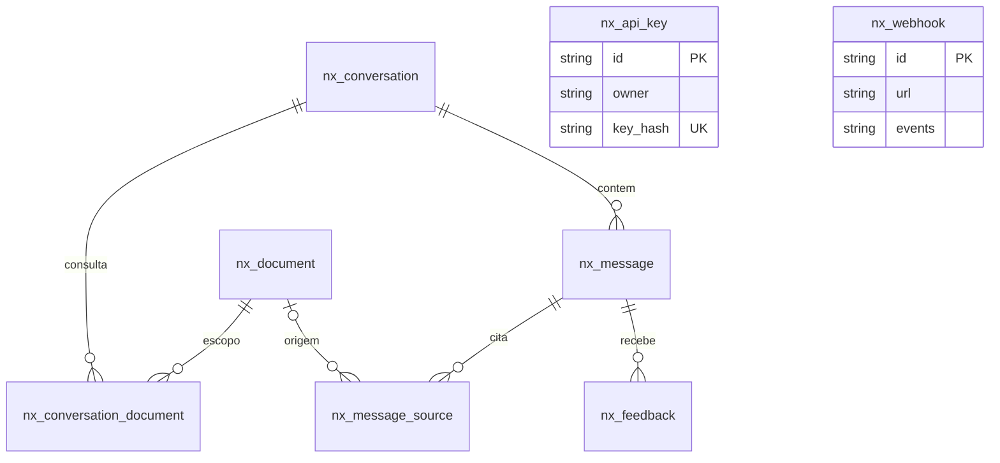

`nx_api_key` e `nx_webhook` ligam-se às contas pelo nome de usuário (as contas ficam em `data/usuarios.json`, fora do banco).

## Estrutura

```
nexo/
  config.py          configuração lida do .env
  db.py              tabelas SQLAlchemy
  users.py           contas em data/usuarios.json
  security.py        tokens JWT e chaves de API
  jobs.py            fila de indexação
  webhooks.py        entrega assinada dos eventos
  rag/
    engine.py        leitura dos PDFs, indexação, busca, reranking e resposta
    providers.py     LLM, embeddings, banco vetorial e reranker configuráveis
    hash_embedding.py  embedding léxico para testes
  api/               rotas FastAPI, esquemas e autenticação
frontend/            interface React + TypeScript (Vite)
  src/pages/         Entrada, Conversas, Busca, Documentos, Painel, Integrações, Sistema
  src/components/    barra lateral, paleta de comandos, trechos com marca-texto
scripts/             avaliação da recuperação, PDF de exemplo, redefinição de senha
exemplos/            PDF fictício e perguntas de avaliação
docs/                manuais em PDF, banco de dados, DDL e imagens
tests/               testes automatizados
```

## API

Documentação interativa em **http://127.0.0.1:8000/api/docs**. Todas as rotas, exceto entrada e cadastro, exigem `Authorization: Bearer <token>` ou uma chave de API.

| Método | Rota | Função |
|---|---|---|
| POST | `/api/auth/login` · `/api/auth/register` | Entrar e criar conta |
| PUT | `/api/auth/password` | Trocar senha |
| GET / POST | `/api/documents` | Listar e enviar PDFs |
| PATCH / DELETE | `/api/documents/{id}` | Renomear e excluir |
| POST | `/api/documents/{id}/reindex` | Reindexar |
| GET | `/api/documents/{id}/file` | Baixar o PDF |
| GET / POST | `/api/conversations` | Listar e criar conversas |
| POST | `/api/conversations/{id}/messages` | Perguntar |
| GET | `/api/conversations/{id}/export` | Exportar em Markdown ou JSON |
| POST | `/api/messages/{id}/feedback` | Avaliar resposta |
| POST | `/api/ask` | Pergunta direta, para integrações |
| POST | `/api/search` | Busca nos trechos, sem LLM |
| GET | `/api/metrics?days=30` | Painel de qualidade |
| GET / POST / DELETE | `/api/keys` · `/api/keys/{id}` | Chaves de API |
| GET / POST / PATCH / DELETE | `/api/webhooks` · `/api/webhooks/{id}` | Webhooks (administrador) |
| POST | `/api/webhooks/{id}/test` | Entrega de teste |
| GET / PATCH / DELETE | `/api/users` · `/api/users/{usuario}` | Contas (administrador) |
| GET | `/api/system/status` | Configuração e números do acervo |

## Avaliar a recuperação

Monte um arquivo JSONL com perguntas e a página que deveria ser encontrada (veja [`exemplos/perguntas-exemplo.jsonl`](exemplos/perguntas-exemplo.jsonl)) e rode:

```bash
python scripts/avaliar.py exemplos/perguntas-exemplo.jsonl --detalhes
```

O script mostra o acerto e o MRR da busca vetorial pura e com reranking, para calibrar `NEXO_TOP_K`, `NEXO_TOP_N` e os cortes de relevância. A tela **Busca nos trechos** faz a mesma conferência pergunta a pergunta.

## Testes

```bash
pip install -r requirements-ci.txt
python -m pytest
```

Os testes usam o modo sem modelos e cobrem autenticação, bloqueio por tentativas, cadastro em arquivo, envio e indexação de PDF, respostas com fontes, pergunta fora do conteúdo, escopo, reranking, permissões, exclusão de vetores, busca nos trechos, exportação, painel de qualidade, chaves de API, pergunta direta, webhooks com assinatura e gestão de contas.

## Licença

[MIT](LICENSE). Use, copie, altere e distribua à vontade. As fontes [Barlow e Barlow Semi Condensed](https://fonts.google.com/specimen/Barlow), [Literata](https://fonts.google.com/specimen/Literata) e [IBM Plex Mono](https://www.ibm.com/plex/) da interface vêm do [Fontsource](https://fontsource.org/) e são distribuídas sob a SIL Open Font License 1.1.
